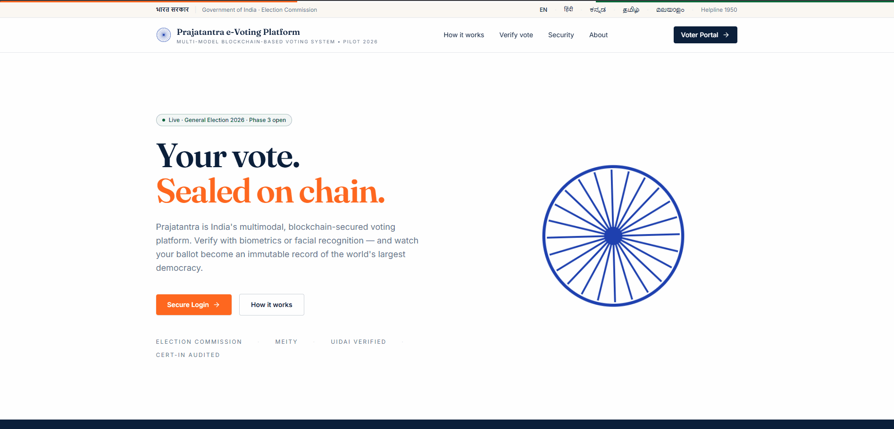

# Multimodal Blockchain Voting System

An academic voting prototype with a React web app, a FastAPI face-authentication service, a SQLite voter registry, and a Solidity contract for election state and vote tallies.



> **Scope:** This is a local/testnet prototype, not a production election system. Face matching, a one-use liveness challenge and eye-close/open checks are limited authentication signals; they are not certified anti-spoofing and cannot guarantee rejection of a well-made replay. The voter registry, eligibility review, credential issuance, and blockchain relayer are trusted centralized services. The public contract records candidate totals and one-time credential hashes; it does not provide cryptographic ballot secrecy or coercion resistance.

## Project layout

```text
src/                         React and TypeScript frontend
server/face-recognition/     FastAPI API, face utilities, SQLite setup, Python tests
server/blockchain/           Solidity contract, Truffle config, migrations, tests
scripts/start-demo.mjs       Starts local Ganache, API, and Vite together
Makefile                     Common setup, run, lint, build, and test commands
```

## Prerequisites

- Node.js supported by Vite 8 (Node 20.19+ or 22.12+ recommended)
- pnpm
- Python 3.11 or 3.12 preferred. Python 3.10 remains a compatibility path with unresolved Pillow advisories; see the security report.
- A webcam for face enrollment and login
- GNU Make for the `make` commands

On Windows, install GNU Make (for example, with Chocolatey or MSYS2) and the Python launcher (`py`). The demo uses the bundled Ganache package; you do not need to start a separate Ganache app.

## Run the local demo

From the repository root:

```bash
make demo
```

The Make target installs the Node and Python dependencies, starts Ganache on port `7545`, deploys the contract, starts FastAPI on port `8000`, then starts Vite on port `8080`. The application uses local chain ID `1337` in demo mode. Add `http://127.0.0.1:7545` / chain ID `1337` to MetaMask if you want to connect a wallet.

Open <http://localhost:8080>. Keep the terminal open while using the app; press **Ctrl+C** there to stop the services. To restart, run `make demo` again after the previous demo has stopped. The launcher exits with an explanation if one of its required ports is already in use.

After ending an election, the administrator can enter a new name in Election Controls and select **Create new election**. MetaMask deploys a fresh contract; once activated, the admin and voter dashboards switch to it automatically, and the previous election's candidates and tally are no longer shown as current. Voter eligibility and participation are tracked separately for each contract. For local demo recovery, `pnpm demo:new-election` (or `make demo-new-election`) remains available after stopping the services.

The demo administrator is `admin_user` by default. If `ADMIN_PASSWORD` is empty in the root `.env`, the launcher generates and saves a password in the ignored `.ganache/demo-admin.json` file. Read that local file to sign in; passwords and Ganache private keys are not printed. The password and signing secret survive restarts. Do not use the deterministic Ganache accounts, development relayer key, or demo credentials with real funds or real elections.

## Environment files

The checked-in examples contain variable names and safe local defaults only. Copy them before configuring a manual or deployed setup:

```powershell
Copy-Item .env.example .env
Copy-Item server/face-recognition/.env.example server/face-recognition/.env
```

On macOS/Linux, use `cp` in place of `Copy-Item`. Keep the resulting `.env` files private; they are ignored by Git. The demo reads the root `.env` for its admin credentials and deployment configuration. FastAPI reads the root `.env` and then `server/face-recognition/.env`, using paths relative to the source directory; environment variables take precedence.

| Variable | Used by | Notes |
| --- | --- | --- |
| `TRUST_PROXY` | Express server | Leave `0` for direct access; set `1` only behind one trusted reverse proxy. |
| `SECRET_KEY` | FastAPI | Set a unique random value; changing it invalidates existing login tokens. |
| `ADMIN_USERNAME`, `ADMIN_PASSWORD` | Demo / FastAPI | The demo saves a generated password locally when the root value is empty. Use a non-default username and strong password outside the demo. |
| `VITE_API_BASE_URL` | Vite frontend | Defaults to the local FastAPI service. Vite variables are public in the browser bundle. |
| `VITE_CONTRACT_ADDRESS`, `VITE_NETWORK_ID` | Vite frontend | The demo supplies the local contract address and chain ID automatically. |
| `MNEMONIC`, `SEPOLIA_RPC_URL`, `RELAYER_ADDRESS` | Truffle | Optional Sepolia deployment configuration. Never commit a mnemonic or private key. |
| `BLOCKCHAIN_*` | FastAPI relayer | Server-only RPC and relayer configuration. Never use a `VITE_` prefix for secrets. |
| `FACE_DB_PATH`, `REDIS_URL`, `FRONTEND_ORIGINS` | FastAPI | Database location, rate-limit store, and allowed browser origins. Redis is optional for local use; the API falls back to in-memory rate limiting. |

Generate a backend secret with:

```bash
python -c "import secrets; print(secrets.token_hex(32))"
```

The root `.env.example` covers the local demo and optional Truffle/Vite settings. The backend-specific example documents FastAPI settings and defaults. The demo launcher compiles contracts, injects the active local contract address and development relayer configuration when it starts the backend, and reuses the saved election contract on normal restart. The dashboard's **Create new election** action activates a new contract without resetting Ganache; `pnpm demo:new-election` provides the same deployment as a local recovery command.

## Manual development

Install frontend dependencies:

```bash
pnpm install
```

Create a Python virtual environment and install the face API dependencies. On Windows:

```powershell
py -3.12 -m venv server/face-recognition/.venv
server/face-recognition/.venv/Scripts/python.exe -m pip install --upgrade "pip>=26.2"
server/face-recognition/.venv/Scripts/python.exe -m pip install -r server/face-recognition/requirements.txt
server/face-recognition/.venv/Scripts/python.exe -m pip install --no-deps "face-recognition>=1.3.0"
```

On macOS/Linux, replace `py -3.12` with `python3.12` and use `.venv/bin/python`. `dlib-bin` supplies the native dlib module; installing the `face-recognition` wrapper with `--no-deps` avoids an unnecessary attempt to build dlib from source. OCR is optional and can be installed with `pip install -r server/face-recognition/requirements-ocr.txt`.

For a complete local voting flow, use `make demo`. For frontend-only work, run `pnpm run dev`. For manual FastAPI startup, set up its `.env` as above and run from the API directory:

```bash
python -m uvicorn main:app --host 127.0.0.1 --port 8000
```

The health endpoint is <http://127.0.0.1:8000/health>.

## Tests and quality checks

Run the full suite:

```bash
make test
```

Or run checks individually:

```bash
pnpm run lint
pnpm run test
pnpm run build
server/face-recognition/.venv/Scripts/python.exe -m pytest server/face-recognition -q
pnpm run test:blockchain
```

The build compiles the Solidity contracts before TypeScript checking and the Vite production bundle. Python tests use temporary SQLite databases, mocked face observations, and a native blank-frame detector check. The integration test starts an isolated ephemeral Ganache chain and sends real signed transactions. No webcam is needed. Compile contracts first for that integration test. Contract tests also start their own Ganache provider.

## How a vote is recorded

1. Register five face images and ID details. New enrollments store a versioned SFace profile with 3–5 consistent templates, not the submitted images. An administrator approves eligibility; pending face replacements require separate approval.
2. Login requests a SQLite-persisted, voter-bound eye-close/open challenge. Head movement is temporarily disabled. The challenge expires after 45 seconds and is atomically consumed once.
3. New profiles use 10 observations in a 1.2-second quick capture. Legacy profiles, spoken guidance, and the more-time option use longer prompt windows. Every submitted observation must match the active profile and pass face-count, replay and bilateral eye-close/open checks. Legacy dlib uses Euclidean tolerance 0.55; SFace uses median cosine similarity >= 0.50 against its templates. These model-specific scores are not interchangeable.
4. A valid session receives an HttpOnly cookie. An eligible voter receives one reusable delivery of the same unused authorization: a random nonce plus a server HMAC produces its bearer value. SQLite stores the nonce and SHA-256 digest, never the bearer cookie.
5. Confirming a candidate reserves a unique `(voter, election)` ballot in a short transaction (`PENDING`). The relayer signs locally and atomically persists its transaction hash, signed bytes and allocated nonce (`SUBMITTED`) **before** broadcast.
6. The API returns HTTP 202 while awaiting confirmation. A background worker checks receipts every ten seconds, including after restart. The UI polls `/api/v1/voter/vote-status` and only shows success for `CONFIRMED`.
7. A canonical successful receipt with `BLOCKCHAIN_CONFIRMATIONS` inclusions permanently consumes the credential. The default is one inclusion for local Ganache. A definitely reverted transaction is `FAILED`; uncertain or dropped transactions retain the reservation and may only resend identical signed bytes.

The contract enforces owner/relayer permissions, election state, candidate validity and credential replay protection. Eligibility and unique human identity remain administrator/service responsibilities. No contract interface changed in this hardening; normal compile regenerates the frontend artifact.

## Security configuration and operations

- Set a stable random `SECRET_KEY` of at least 32 bytes and a strong `ADMIN_PASSWORD` (12+ characters, at least one digit, at most 72 UTF-8 bytes). Missing/invalid required authentication configuration fails startup.
- Use HTTPS outside localhost, `COOKIE_SECURE=true`, explicit `FRONTEND_ORIGINS`, and `COOKIE_SAMESITE=lax` or `strict`. State-changing browser requests reject untrusted origins. Never place secrets in `VITE_` variables.
- Set `REQUIRE_REDIS=true` for multiple API workers. All workers must share **one local SQLite database** and one exclusive relayer key. Do not use that relayer for unrelated transactions or share the SQLite file over a network filesystem.
- WAL with `synchronous=FULL`, short write transactions and a unique ballot reservation prevent a receipt delay from holding SQLite locked. Back up SQLite with its backup API; do not copy only the main database while WAL is active.
- JWTs require expiration, session ID, current account role and session version. Logout persists revocation; face/eligibility changes invalidate existing sessions. Legacy JWTs without these claims require a fresh login.
- `IMPORT_LEGACY_PICKLE=false` disables automatic pickle loading. Enable only for an offline import of a trusted file; an adjacent checksum is not proof of authenticity.
- `SEED_DEMO_ROSTER=false` keeps the bundled academic roster out of normal deployments. The local demo explicitly enables it. The roster contains personal information and must not be treated as an anonymous test dataset.
- Requests are bounded to 12 MB before JSON parsing and camera images to supported JPEG/PNG dimensions. Each API process admits one expensive CV request at a time, with login frames distributed across a bounded, warmed process pool. Models are reused. Logs record processing duration without embeddings or images.
- Audit exports require actual blockchain data at a consistent confirmation-policy snapshot. They return 503 if unavailable instead of inventing ledger records. `canonical_payload` specifies exactly what the digest covers. ECDSA signatures use the configured relayer; the explicitly labeled HMAC fallback is only server-verifiable, not a public signature.

### Existing database migration

Startup adds the challenge/session tables, credential nonce column, signed transaction outbox and unique reservation index without deleting voting history. Voter deletion disables login and clears biometric profiles while preserving spent/uncertain authorizations.

**Old unconsumed credentials are quarantined**, including revoked ones: the previous implementation could broadcast before recording a transaction hash. Their local state cannot prove that no ballot was accepted. Review the existing election ledger before resolving them, or deliberately deploy a new election. Never clear an uncertain reservation merely to enable another vote. Pre-signing `PENDING` reservations can be released after two minutes; signed `SUBMITTED` reservations cannot.

### Manual blockchain setup

```bash
pnpm exec ganache --server.host 127.0.0.1 --port 7545 --chain.chainId 1337
pnpm run compile:contracts
pnpm exec truffle migrate --network development
```

Configure the deployed address, relayer key/address and RPC URL in the backend environment and the contract address/network ID in Vite before building. Fund the relayer with test currency. Only use `truffle migrate --reset` when intentionally starting a new election. For Sepolia, install the optional `@truffle/hdwallet-provider` and supply the server-side mnemonic/RPC settings; that deployment was not exercised here.

`pnpm run serve` serves the built frontend through Express. The Docker definitions require an external configured blockchain RPC; they do not start a blockchain. Docker builds were not run in this Windows environment.

## Limitations and validation

### Face login performance and image updates

**Restart the demo after updating the code.** The UI detects an old running backend and asks for a restart instead of recording a capture it cannot process correctly. `/health` reports `face_engine_version: 3` for this implementation.

The fast path uses pinned OpenCV YuNet/SFace models, warmed in four isolated CPU workers. `make install-python` and `npm run demo` install/verify the model files automatically; manual installations must run `python server/face-recognition/face_models.py` once. Model files are SHA-256 checked against a pinned OpenCV Zoo revision. Authentication never downloads a model. See `server/face-recognition/models/` for licenses.

**Existing dlib profiles cannot be converted without new face images.** They remain supported, but use the slower model. To enable quick login, capture your face once after restarting, then have an administrator select **Approve face update** after verifying your ID. Until approval, the previous profile remains active. The login page reports pending/active status. Approval invalidates previous sessions and records the activation time.

Head movement is temporarily disabled at the user's request. Quick capture now takes 1.2 seconds for 10 frames; guided capture takes 2.4 seconds for 16 frames. Keep still, close both eyes, then reopen them when prompted. Use **Give me more time for the eye prompts** if needed; voice guidance uses this longer option. Identity is still checked on every frame. This reduces capture and inference work but also removes the randomized head-turn challenge's additional spoof resistance. The new total login latency has not been benchmarked, and no tests were run for this change as requested.

`FACE_WORKERS` defaults to up to four processes; use 2 on memory-limited hosts. Use one Uvicorn API process on a laptop because every API process owns its own pool. Requests fail quickly under CV contention rather than waiting in a long queue. Inference and browser deadlines remain 15 and 30 seconds respectively. Decode/inference timing appears in backend logs and the success response's `Server-Timing` header; images and embeddings are not logged.

Opt-in benchmark using three public example photographs (no voter DB access):

```powershell
server/face-recognition/.venv/Scripts/python.exe server/face-recognition/benchmark_fast_face.py --output docs/security/fast-face-benchmark-2026-11-02.json
```

Read the [recognition update report](docs/security/face-recognition-update-2026-11-02.md) and [raw benchmark](docs/security/fast-face-benchmark-2026-11-02.json). The examples are a smoke check, not population accuracy or spoof-resistance evidence. SFace's 0.50 threshold is a conservative initial setting requiring consented deployment-specific calibration.

This remains an academic prototype. Randomized RGB liveness reduces simple presentation attacks but does not attest camera hardware, prevent sophisticated adaptive video/deepfake injection, or prove continuous unobserved camera frames. Capture timestamps originate from an untrusted browser; server expiry and minimum elapsed time bound the attempt but do not prove physical capture timing. Real-user false-accept/false-reject rates and latency need consented webcam testing; no accuracy or latency guarantee is claimed.

Embeddings are sensitive and remain in the local SQLite database without application-level encryption. Restrict service-account/file access, encrypt the disk/backups, and define retention. The backend's voter-to-transaction mapping, public ballot choices and timing prevent a claim of cryptographic anonymity or coercion resistance. One approved ID is not proof of one unique human if administrators approve duplicate identities.

Read the [audit and final validation report](docs/security/hardening-report-2026-11-01.md), including remaining dependency advisories and the Python 3.10 / legacy model-package compatibility constraints. The standalone `blink_detection.py` is a desktop demonstration, not the login verifier; it needs GUI-enabled OpenCV. Offline `mass_enroll.py` uses the configured database, requires five samples named `VOTER-ID__01.jpg` etc., and queues existing-profile replacements for approval.

## License

This project is licensed under the MIT License - see the [LICENSE](LICENSE) file for details.
